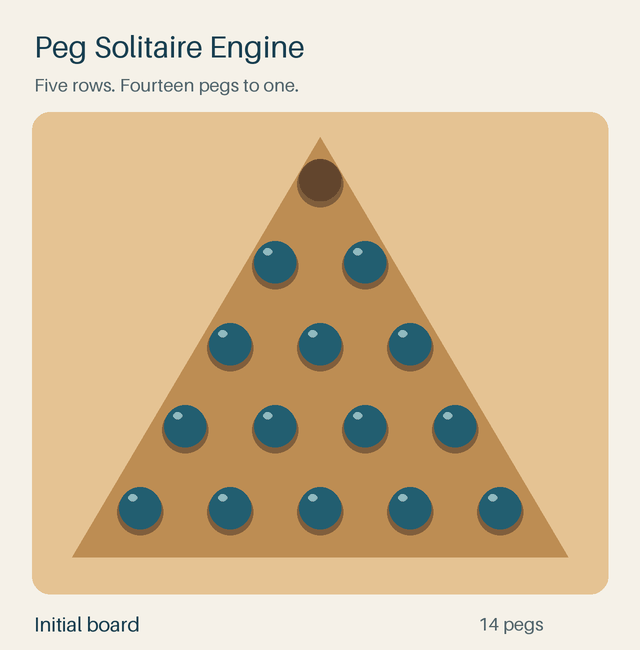

# Peg Solitaire Engine

Peg Solitaire Engine explores algorithms for solving triangular [peg solitaire](https://en.wikipedia.org/wiki/Peg_solitaire). Choose an initial hole and a goal, then search for a sequence of jumps that leaves the final peg in that cell.



*A complete solution: the board starts with 14 pegs and an empty top cell. After 13 jumps, the remaining peg returns to the top.*

## Motivation

Peg solitaire is a small game with a surprisingly large search space. A move that looks useful can leave a board with no way to finish, and different paths can lead back to the same unsuccessful position.

We wanted to explore how backtracking, remembered failures, and pagoda functions change the way we search that space. The triangular board makes the process easy to follow: every jump removes one peg, and a solution is a path from the initial arrangement to a particular goal.

## The board

A triangle with `n` rows has `n(n + 1) / 2` cells. Each cell is represented by a coordinate and a value: `1` for a peg, `0` for a hole.

We precompute every line of three adjacent cells. A jump changes `(1, 1, 0)` into `(0, 0, 1)`, or `(0, 1, 1)` into `(1, 0, 0)`. Toggling the same three cells again undoes the move during search.

The [board implementation](board_logic/board.py) handles these positions, jumps, and board representations. The goal is an exact arrangement, so a final peg in a different cell does not count as a solution.

## Algorithms

### Backtracking

The solver tries a legal jump, continues from the resulting board, and undoes the jump if that path cannot reach the goal. This is depth-first search over the possible board states.

### Remembering failed states

When a position has no solution, its representation is stored in a set. If another path reaches that same position, the solver can skip it instead of repeating the work. The set is cleared for each new search because a failure for one goal may be a success for another.

Failed states are cached in their exact orientation so the cache respects the selected goal.

### Pagoda functions

A pagoda function assigns a weight to each cell so that a legal jump cannot increase the total weight of the occupied cells. If a position's total falls below the goal's total, that position cannot reach the goal and can be pruned.

The [generator](algorithms/pagoda/pagoda.py) searches for weights in `{-1, 0, 1}` that satisfy the jump constraints. The [solver](algorithms/backtracking/backtracking.py) can use those weights alongside backtracking and failed-state memoization. If no suitable function is found, it continues without that pruning rule.

## Running the project

Use Python 3.10 or newer. The web interface uses Flask 3.0.

```sh
git clone https://github.com/TheDeafOne/PegSolitaireEngine.git
cd PegSolitaireEngine
python -m venv .venv
```

Activate the environment with `source .venv/bin/activate` on macOS/Linux, or `.venv\Scripts\Activate.ps1` in Windows PowerShell. Then install and run:

```sh
python -m pip install -r requirements.txt
python -m visualization.webapp.webapp_visualizer
```

Open [http://127.0.0.1:5000](http://127.0.0.1:5000).

1. Enter a board size. Start with **5**; the initial hole and goal default to the top cell.
2. To change either, select **Set Initial State** or **Set Goal State**, then click a cell.
3. Select **Run** to find and replay a solution.
4. Enable **Show search live** to watch explored positions, including unsuccessful branches, rather than only the final solution.
5. Use **Reset / cancel** to stop a search or replay and restore the initial board.

The web application reports solved, unsolved, cancelled, and error outcomes. Each search owns its board and worker, so starting another search does not replace the board being used by an older one. The web interface accepts sizes 2–10, but larger boards can still take a long time: the search space grows quickly.

For the console menu, run `python user_test.py` and choose `c`. Choosing `w` opens the same web application. Stop the console menu with Ctrl+C.

## Using the solver directly

```python
from board_logic.board import Board
from algorithms.backtracking.backtracking import Backtrack

board = Board(5, initial_state_positions=[(0, 0)],
              goal_state_positions=[(0, 0)])
solver = Backtrack(use_pagoda=True)
states = solver.backtrack(board)

if solver.did_solve:
    print(f"Solved in {len(states)} jumps")
else:
    print("No solution")
```

Coordinates are `(column, row)`, starting at zero. `initial_state_positions` lists the holes; `goal_state_positions` lists the occupied goal cells. A successful result contains the board state after each jump. Check `did_solve` to distinguish an already-solved board, whose path is empty, from an unsuccessful search.

## Replay and checks

The [recorded states](docs/solution.json) include the initial board and all 13 jumps. To regenerate the GIF and still images:

```sh
python -m pip install -r requirements-demo.txt
python tools/render_solution.py
```

The renderer checks every jump against the board's legal positions and verifies the final goal before writing the images.

Run the solver and web-job checks with:

```sh
python -m unittest discover -s tests -v
```

These include every three-row board state and one-peg goal, compared with an independent breadth-first reference, both with and without pagoda pruning. They also cover cancellation, unsolvable searches, independent workers, errors, and the web endpoints. If Node.js is available, `node tests/check_web_script.cjs` checks stale-request cancellation and replay handling without launching a browser.

## Paper

We discuss the heuristics, methods, and algorithmic variations further in [Solving Peg Solitaire with Advanced Backtracking](solving_peg_solitaire_with_adv_backtracking.pdf).
